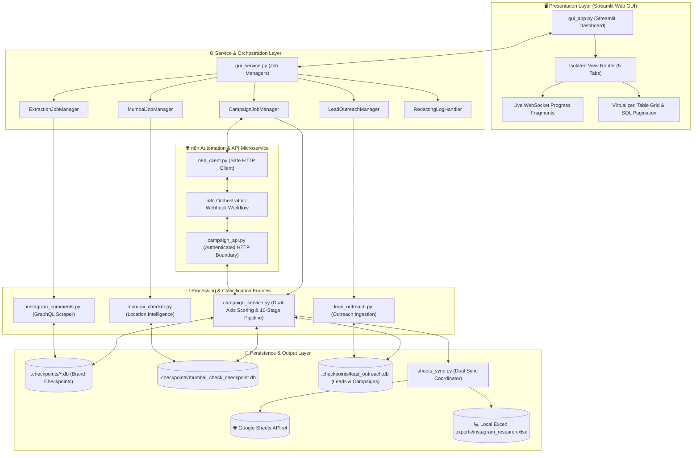
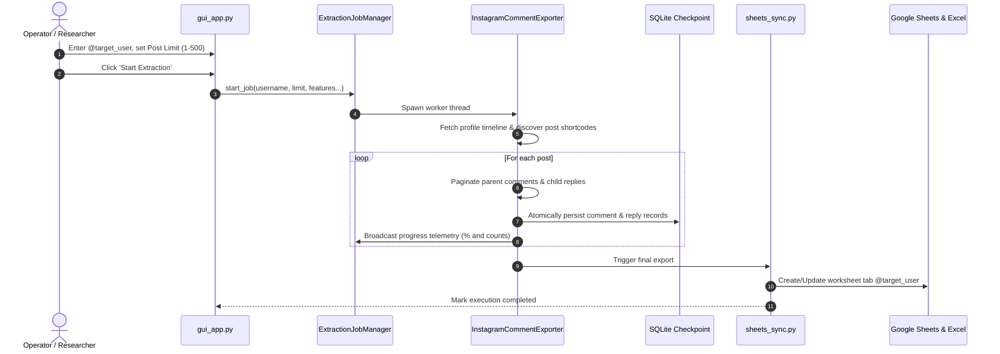
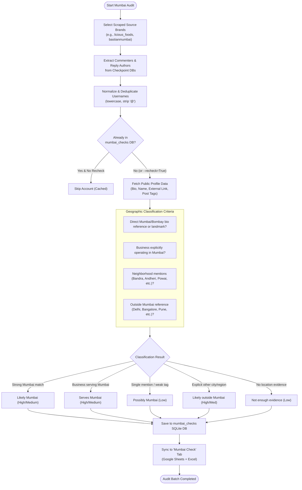

# BuildInfo.md — Instagram Comment Exporter & Mumbai Location Checker Suite

> **Comprehensive System Documentation, Technical Architecture, and Operational Workflows**  
> *Project Location:* `/home/nars/projects/api-anything-api/api-anything`  
> *Default Google Spreadsheet:* [`1sLCfz9Eho4OWjsDTILIVKNRtwVYbCoibFK6z6un7c_Y`](https://docs.google.com/spreadsheets/d/1sLCfz9Eho4OWjsDTILIVKNRtwVYbCoibFK6z6un7c_Y/edit)  
> *Default Local Excel Mirror:* `exports/instagram_research.xlsx`

---

## 1. Executive Summary & Capabilities

This project is an enterprise-grade Instagram Public Intelligence, Engagement Extraction, and Demographic Audit platform designed for audience research, brand analysis, and hyper-local geographical profiling.

### Key Capabilities
1. **Public Timeline & Comment Extraction**:
   - Discovers public posts from any Instagram handle (supports 1 to 500 posts).
   - Extracts top-level comments and nested child replies with full author attribution, timestamps, and like counts.
   - Real-time fault tolerance with transactional SQLite checkpointing to ensure zero data loss during network disruptions.
2. **Dual-Destination Live Synchronization**:
   - **Google Sheets API v4**: Updates individual brand tabs with bold headers, freeze panes, auto-fitted column widths, and direct clickable post URLs.
   - **Local Excel Workbook (`exports/instagram_research.xlsx`)**: Offline mirror matching Google Sheets structure and formatting.
3. **Mumbai Location Checker (Audience Demographics Engine)**:
   - Targets the **people who comment and reply** on brand posts rather than the source brand itself.
   - Normalizes and deduplicates usernames across multiple brand profiles.
   - Collects public evidence (display name, biography, external website links, post location tags, and Mumbai-specific neighborhood keywords).
   - Classifies users into standard tiers: `Likely Mumbai`, `Serves Mumbai`, `Possibly Mumbai`, `Likely outside Mumbai`, and `Not enough evidence`.
   - Records auditable reasoning, confidence ratings, and timestamps.
4. **Modern Graphite Web GUI**:
   - Streamlit dashboard featuring isolated sub-view routing.
   - Real-time progress monitoring using WebSocket fragments (`@st.fragment`).
   - Virtualized canvas grids with server-side SQL pagination (`LIMIT / OFFSET`) capable of handling thousands of accounts without browser lag.
5. **MeatNDoor Lead Outreach Manager**:
   - Incremental and idempotent ingestion from brand checkpoint databases.
   - Location-based campaign eligibility (`Likely Mumbai` -> Target, `Serves Mumbai` -> Review, `Possibly Mumbai` -> Review, `Likely outside Mumbai` -> Suppressed, `DNC` -> Suppressed).
   - Editable message drafting for Mumbai-specific and generic food lover outreach.
   - Actionable review queue with 1-click status transitions and persistent operator audit logs.
   - Official Meta compliance links (`https://ig.me/m/{username}`) and dual Google Sheets / Excel reporting.
6. **n8n Campaign Automation & Lead Intelligence Engine**:
   - 10-stage end-to-end pipeline coordinating ingestion, Mumbai location qualification, dual-axis lead scoring, drafting, and reporting.
   - Dual-axis scoring separating explicit buying intent signals (0-50 pts) from geographic residency confidence (0-50 pts) = Total Score (0-100 pts).
   - Dedicated Streamlit `🎯 Campaign Manager` tab with real-time telemetry, stage progression, pause/resume/cancel controls, and SQL-paginated review queue.
   - n8n orchestrator integration (`n8n_client.py`), lightweight HTTP microservice boundary (`campaign_api.py`), and importable 13-node workflow blueprint (`meatndoor_campaign.json`).
   - Resilient execution with native Python pipeline fallback when n8n is offline or unconfigured.


---

## 2. High-Level System Architecture



---

## 3. Module Breakdown & Responsibilities

| File | Primary Role | Description & Architectural Details |
|---|---|---|
| [`instagram_comments.py`](file:///home/nars/projects/api-anything-api/instagram_comments.py) | **Core Extraction Engine** | Scrapes public posts, comments, and replies using public Instagram web endpoints and GraphQL queries (`graphql/query/?query_hash=...`). Implements progressive backoff, randomized jitter, and SQLite atomic checkpointing. |
| [`mumbai_checker.py`](file:///home/nars/projects/api-anything-api/mumbai_checker.py) | **Location Intelligence Engine** | Manages commenter discovery across SQLite databases, username deduplication, public profile evidence harvesting, rule-based Mumbai classification, and the `mumbai_checks` database. |
| [`sheets_sync.py`](file:///home/nars/projects/api-anything-api/sheets_sync.py) | **Dual Sync Coordinator** | Manages authentication and batch formatting for Google Sheets API v4 (Service Account or interactive OAuth) and synchronizes identical worksheets to local Excel files via `openpyxl`. |
| [`lead_outreach.py`](file:///home/nars/projects/api-anything-api/lead_outreach.py) | **Lead Outreach Engine** | Manages commenter/reply ingestion, Mumbai location eligibility, outside/DNC suppression, message drafting, review queue, Meta compliance links, and dual sync. |
| [`campaign_service.py`](file:///home/nars/projects/api-anything-api/campaign_service.py) | **Campaign Automation Engine** | Implements the 10-stage execution pipeline, SQLite campaign schema (`campaigns`, `campaign_leads`, `campaign_executions`), dual-axis intent scoring (0-100), resumable checkpoints, pause/resume/cancel controls, and Excel/Sheets campaign synchronization. |
| [`n8n_client.py`](file:///home/nars/projects/api-anything-api/n8n_client.py) | **n8n Webhook Client** | Handles webhook URL validation, campaign payload construction, authentication headers (`X-Webhook-Secret`, `X-N8N-API-KEY`), execution status polling, and connection health checks. |
| [`campaign_api.py`](file:///home/nars/projects/api-anything-api/campaign_api.py) | **Campaign Microservice API** | Zero-dependency authenticated HTTP server using Python standard library `http.server.ThreadingHTTPServer`. Provides `/health`, `/campaign/start`, `/campaign/<id>/status`, `/pause`, `/resume`, `/cancel`, and `/sync` endpoints. |
| [`n8n_workflows/meatndoor_campaign.json`](file:///home/nars/projects/api-anything-api/n8n_workflows/meatndoor_campaign.json) | **n8n Workflow Blueprint** | 13-node production n8n workflow implementing webhook trigger, validation, execution triggering, response formatting, and error handling. |
| [`gui_service.py`](file:///home/nars/projects/api-anything-api/gui_service.py) | **Background Job Manager** | Thread-safe singleton controllers (`ExtractionJobManager`, `MumbaiJobManager`, `LeadOutreachManager`, `CampaignJobManager`) that execute workers in daemon threads while maintaining telemetry and redacted log buffers. |
| [`gui_app.py`](file:///home/nars/projects/api-anything-api/gui_app.py) | **Web Interface** | Streamlit application featuring dark graphite styling, isolated page routing, `@st.fragment` telemetry polling, and paginated SQL queries. |
| [`run_gui.sh`](file:///home/nars/projects/api-anything-api/run_gui.sh) | **Launcher Script** | Shell wrapper that validates Python 3 and dependencies, sets `PYTHONPATH`, and launches the Streamlit server on port `8501`. |


---

## 4. End-to-End Operational Workflows

### Workflow 1: Public Post & Comment Extraction



#### Detailed Steps:
1. **Target Identification**: User inputs target account (e.g. `licious_foods`).
2. **Timeline Discovery**: Scraper retrieves post shortcodes up to the user-selected cap (up to 500 posts).
3. **Comment & Reply Traversal**:
   - Queries comments with end-cursor pagination.
   - For comments with `child_comment_count > 0`, issues GraphQL calls to fetch child replies.
4. **Resumable Storage**: Checkpoints are stored in `.checkpoints/{username}_checkpoint.db`. If stopped or interrupted, subsequent runs resume from the exact post cursor.
5. **Dual Sync**:
   - Generates formatted rows: `Type`, `Post URL`, `Commenter Username`, `Text`, `Likes`, `Timestamp`.
   - Syncs to Google Sheet worksheet `licious_foods` and updates `exports/instagram_research.xlsx`.

---

### Workflow 2: Mumbai Audience Demographics Audit



#### Geographic Evidence Signals Used by Classifier:
- **Neighborhoods & Suburbs**: Bandra, Juhu, Andheri, Colaba, Powai, Dadar, Worli, Malad, Borivali, Chembur, Ghatkopar, Thane, Navi Mumbai, Vashi, Khar, Santacruz, Goregaon.
- **Landmarks & Vernacular**: Bombay, Marine Drive, Nariman Point, BKC, CST, Churchgate, Gateway of India.
- **Pincodes**: `400001` through `400104`.
- **Negative Disqualification**: Explicit markers for other cities (e.g. `Delhi`, `Bengaluru`, `Bangalore`, `Hyderabad`, `Pune`, `Kolkata`, `Chennai`) categorize accounts into `Likely outside Mumbai`.
- **Error Shielding**: If an account was previously classified with positive evidence, a subsequent network timeout or rate limit will **never overwrite** the valid record with an error state.

---

## 5. Performance & Scalability Architecture

When dealing with 3,000+ audited accounts and tens of thousands of comments, traditional Streamlit applications suffer from extreme frontend lag. The following optimizations resolve this:

### 1. Isolated Sub-View Navigation
- Standard Streamlit `st.tabs` executes all tabs on every single rerun.
- Replaced with dynamic conditional routing (`st.radio`). Only the selected view executes:
  - When viewing **📍 Mumbai Location Checker**, the Extractor, History, and Health views consume **0% CPU** and perform zero I/O.

### 2. Auto-Refreshing Telemetry Fragments (`@st.fragment`)
- Eliminated `time.sleep(1.5)` + `st.rerun()` polling loops.
- Live progress metrics are enclosed in `@st.fragment(run_every="2s")`.
- Only the progress bar and number badges refresh over WebSocket. The outer application, forms, search inputs, and tables remain completely static and interactive.

### 3. Server-Side SQL Pagination & Filtering
- Never loads 3,000+ records into Python memory at once.
- Built SQL-level filtering and pagination into [`MumbaiCheckDB`](file:///home/nars/projects/api-anything-api/mumbai_checker.py#L360-L415):
  ```sql
  SELECT * FROM mumbai_checks 
  WHERE classification = ? AND (checked_username LIKE ? OR ...)
  ORDER BY checked_at DESC 
  LIMIT ? OFFSET ?
  ```
- Renders only the active page (25, 50, or 100 rows) using a canvas-virtualized `st.dataframe`.

### 4. Zero-I/O Metadata Pre-Summary
- The Target Pre-Check Summary reads pre-aggregated counts (`unique_commenters`, `total_records`) directly from checkpoint metadata without executing full `SELECT * FROM comments` queries during page load.

---

## 6. Data Schemas

### 1. Comment & Reply Checkpoint Schema (`comments` table)
```sql
CREATE TABLE comments (
    id TEXT PRIMARY KEY,
    record_type TEXT NOT NULL,       -- 'comment' or 'reply'
    parent_comment_id TEXT,          -- NULL for comments, parent id for replies
    post_shortcode TEXT NOT NULL,
    post_url TEXT NOT NULL,
    post_timestamp TEXT,
    comment_id TEXT NOT NULL,
    username TEXT NOT NULL,
    display_name TEXT,
    text TEXT,
    like_count INTEGER DEFAULT 0,
    created_at TEXT,
    extracted_at TEXT NOT NULL
);
```

### 2. Mumbai Audit Database Schema (`mumbai_checks` table)
```sql
CREATE TABLE mumbai_checks (
    normalized_username TEXT PRIMARY KEY,   -- lower(ltrim(username, '@'))
    checked_username TEXT NOT NULL,          -- Preserved original casing
    profile_url TEXT NOT NULL,
    display_name TEXT,
    stated_location TEXT,                    -- Extracted city/neighborhood
    evidence_summary TEXT NOT NULL,          -- Brief auditable reasoning
    classification TEXT NOT NULL,            -- Likely Mumbai, Serves Mumbai, etc.
    confidence TEXT NOT NULL,                -- High, Medium, Low
    checked_at TEXT NOT NULL,                -- ISO UTC timestamp
    has_error INTEGER DEFAULT 0,             -- 1 if transient failure
    error_message TEXT DEFAULT '',
    source_accounts TEXT DEFAULT '',         -- Brand profiles where user interacted
    raw_evidence_json TEXT                   -- Serialized JSON of raw bio/tags
);
```

### 3. Google Sheets / Excel Schema (`Mumbai Check` worksheet)
| Column | Header | Description |
|---|---|---|
| A | **Username** | `@handle` with hyperlink to Instagram profile |
| B | **Profile URL** | Plain URL string |
| C | **Display Name** | Public name set on user profile |
| D | **Source Account(s)** | Brand posts where commenter was found |
| E | **Publicly Stated Location**| City, neighborhood, or pincode |
| F | **Evidence Summary** | Specific signals detected |
| G | **Classification** | Standard classification category |
| H | **Confidence** | `High`, `Medium`, or `Low` |
| I | **Checked Timestamp** | Time audited in UTC |

### 4. Outreach Queue Database Schema (`outreach_leads` table in `.checkpoints/lead_outreach.db`)
```sql
CREATE TABLE outreach_leads (
    normalized_username TEXT PRIMARY KEY,
    username TEXT NOT NULL,
    profile_url TEXT NOT NULL,
    direct_message_url TEXT NOT NULL,       -- https://ig.me/m/{username}
    source_brands TEXT NOT NULL,            -- JSON array of competitor accounts
    source_posts TEXT NOT NULL,             -- JSON array of post shortcodes
    total_comments INTEGER DEFAULT 1,
    comment_types TEXT DEFAULT '',          -- 'comment', 'reply'
    sample_comment_text TEXT DEFAULT '',
    mumbai_classification TEXT NOT NULL,    -- Likely Mumbai, Serves Mumbai, etc.
    mumbai_confidence TEXT NOT NULL,        -- High, Medium, Low
    stated_location TEXT DEFAULT '',
    evidence_summary TEXT DEFAULT '',
    campaign TEXT NOT NULL,                 -- MeatNDoor Mumbai Launch
    campaign_eligibility TEXT NOT NULL,     -- Eligible (Mumbai Target), Suppressed, etc.
    drafted_message TEXT NOT NULL,          -- Editable message draft
    review_status TEXT NOT NULL,            -- Pending Review, Approved, Contacted, etc.
    is_dnc INTEGER DEFAULT 0,
    dnc_reason TEXT DEFAULT '',
    messaging_status TEXT NOT NULL,         -- Manual / Opt-In Required, Sent via API
    last_action TEXT DEFAULT 'Ingested',
    last_action_at TEXT NOT NULL,
    created_at TEXT NOT NULL,
    updated_at TEXT NOT NULL
);

CREATE TABLE do_not_contact (
    normalized_username TEXT PRIMARY KEY,
    username TEXT NOT NULL,
    reason TEXT NOT NULL,
    added_at TEXT NOT NULL,
    added_by TEXT DEFAULT 'Operator'
);

CREATE TABLE outreach_audit_log (
    id INTEGER PRIMARY KEY AUTOINCREMENT,
    normalized_username TEXT NOT NULL,
    action TEXT NOT NULL,
    previous_status TEXT,
    new_status TEXT,
    notes TEXT,
    operator TEXT DEFAULT 'Operator',
    created_at TEXT NOT NULL
);
```

### 5. Google Sheets / Excel Schema (`Outreach Manager` worksheet)
| Column | Header | Description |
|---|---|---|
| A | **Username** | `@handle` with hyperlink to Instagram profile |
| B | **Profile URL** | Direct web profile URL |
| C | **Direct Chat (ig.me)** | Clickable 1-click compliant chat URL (`https://ig.me/m/{username}`) |
| D | **Source Brands** | Competitor brand posts where user commented |
| E | **Source Posts** | Shortcodes of specific engaged posts |
| F | **Total Comments** | Total comments + child replies authored |
| G | **Location Classification** | Mumbai location intelligence tier |
| H | **Confidence** | `High`, `Medium`, or `Low` |
| I | **Stated Location** | Detected suburb/landmark or city |
| J | **Campaign Eligibility** | `Eligible (Mumbai Target)`, `Suppressed`, etc. |
| K | **Review Status** | `Pending Review`, `Approved`, `Contacted`, `Replied`, `DNC` |
| L | **Drafted Outreach Message**| Standardized or customized message copy |
| M | **Messaging Status** | `Manual / Opt-In Required`, `Sent via API` |
| N | **Last Action** | Operator transition or update trigger |
| O | **Updated UTC** | Timestamp of last modification |

### 6. Campaign Automation Schemas (`campaigns`, `campaign_leads`, `campaign_executions`)
```sql
CREATE TABLE campaigns (
    campaign_id TEXT PRIMARY KEY,
    name TEXT NOT NULL,
    objective TEXT NOT NULL,
    target_location TEXT NOT NULL,
    source_accounts TEXT NOT NULL,          -- JSON array of brand accounts
    max_leads INTEGER DEFAULT 500,
    min_lead_score INTEGER DEFAULT 0,
    status TEXT NOT NULL DEFAULT 'draft',   -- 'draft', 'running', 'paused', 'completed', 'cancelled', 'failed'
    n8n_workflow_id TEXT DEFAULT '',
    n8n_execution_id TEXT DEFAULT '',
    notes TEXT DEFAULT '',
    leads_discovered INTEGER DEFAULT 0,
    leads_processed INTEGER DEFAULT 0,
    leads_qualified INTEGER DEFAULT 0,
    leads_suppressed INTEGER DEFAULT 0,
    drafts_generated INTEGER DEFAULT 0,
    awaiting_review INTEGER DEFAULT 0,
    authorized_messages INTEGER DEFAULT 0,
    failed_operations INTEGER DEFAULT 0,
    current_stage TEXT DEFAULT 'Configured',
    checkpoint TEXT DEFAULT 'stage_0',
    start_time TEXT,
    completion_time TEXT,
    created_at TEXT NOT NULL,
    updated_at TEXT NOT NULL
);

CREATE TABLE campaign_leads (
    campaign_id TEXT NOT NULL,
    normalized_username TEXT NOT NULL,
    username TEXT NOT NULL,
    profile_url TEXT NOT NULL,
    source_accounts TEXT NOT NULL,          -- JSON array of competitor accounts
    intent_evidence TEXT DEFAULT '',        -- Detected buying intent signals
    location_category TEXT NOT NULL,        -- Mumbai classification tier
    location_confidence TEXT NOT NULL,      -- High, Medium, Low
    location_score INTEGER DEFAULT 0,       -- 0 to 50 pts
    intent_score INTEGER DEFAULT 0,         -- 0 to 50 pts
    lead_score INTEGER DEFAULT 0,          -- 0 to 100 pts (dual-axis total)
    suggested_message TEXT NOT NULL,        -- Editable personalized draft
    campaign_status TEXT NOT NULL,          -- 'eligible', 'suppressed', 'removed'
    approval_status TEXT NOT NULL DEFAULT 'pending', -- 'pending', 'approved', 'rejected'
    contact_status TEXT NOT NULL DEFAULT 'not_contacted',
    dnc_status INTEGER DEFAULT 0,
    suppression_reason TEXT DEFAULT '',
    last_action TEXT DEFAULT 'Ingested',
    last_action_at TEXT NOT NULL,
    created_at TEXT NOT NULL,
    updated_at TEXT NOT NULL,
    PRIMARY KEY (campaign_id, normalized_username)
);

CREATE TABLE campaign_executions (
    execution_id TEXT PRIMARY KEY,
    campaign_id TEXT NOT NULL,
    trigger_source TEXT NOT NULL,           -- 'n8n_workflow', 'manual_gui', 'api_webhook'
    status TEXT NOT NULL,
    stage TEXT NOT NULL,
    metrics_json TEXT NOT NULL,
    started_at TEXT NOT NULL,
    ended_at TEXT,
    error_message TEXT DEFAULT ''
);
```

### 7. Google Sheets / Excel Schema (`Campaign Leads` worksheet)
| Column | Header | Description |
|---|---|---|
| A | **Username** | `@handle` with hyperlink to Instagram profile |
| B | **Total Score** | Dual-axis lead qualification score (0–100) |
| C | **Location Score** | Geographical residency confidence score (0–50) |
| D | **Intent Score** | Explicit buying interest score (0–50) |
| E | **Intent Evidence** | Detected intent signals (mutton, delivery, question, etc.) |
| F | **Location Category** | `Likely Mumbai`, `Serves Mumbai`, etc. |
| G | **Confidence** | `High`, `Medium`, or `Low` |
| H | **Campaign Status** | `eligible` or `suppressed` |
| I | **Approval Status** | `pending`, `approved`, or `rejected` |
| J | **Contact Status** | `not_contacted`, `contacted`, `replied`, `interested`, `not_interested` |
| K | **Personalized Draft** | Ready-to-use message draft |
| L | **Direct Chat (ig.me)** | Compliant 1-click web chat URL (`https://ig.me/m/{username}`) |
| M | **Source Accounts** | Scraped brand profiles where commenter engaged |
| N | **Suppression Reason** | Reason for exclusion (if suppressed) |
| O | **Last Action** | Operator decision or pipeline step |
| P | **Updated UTC** | Timestamp of last modification |

---


## 7. Google Sheets Authentication Setup

The suite supports two authentication methods (configured in `sheets_sync.py`):

### Method 1: Service Account (Recommended for Automated Execution)
1. In Google Cloud Console, enable the **Google Sheets API** and **Google Drive API**.
2. Create a Service Account and download the private JSON key.
3. Save the key file as `service_account.json` in the project root.
4. Open the target Google Spreadsheet ([`1sLCfz9Eho4OWjsDTILIVKNRtwVYbCoibFK6z6un7c_Y`](https://docs.google.com/spreadsheets/d/1sLCfz9Eho4OWjsDTILIVKNRtwVYbCoibFK6z6un7c_Y/edit)).
5. Click **Share** and add the service account's `client_email` with **Editor** access.

### Method 2: Interactive OAuth 2.0 (Desktop App)
1. In Google Cloud Console, create an OAuth 2.0 Client ID (Application type: *Desktop App*).
2. Download the client credentials file as `credentials.json` in the project root.
3. On first run, a browser window will open requesting consent. Once granted, credentials are saved to `token.json`.

---

## 8. Installation & Execution Guide

### Local Environment Setup (Linux / macOS)

1. **Clone or Navigate to the Repository**:
   ```bash
   cd /home/nars/projects/api-anything-api
   ```
2. **Create and Activate Python Virtual Environment**:
   ```bash
   python3 -m venv venv
   source venv/bin/activate
   ```
3. **Install Dependencies**:
   ```bash
   pip install --upgrade pip
   pip install -r requirements.txt
   ```

### Running the Web GUI
Launch the Streamlit interface:
```bash
./run_gui.sh
```
Or directly via Python:
```bash
streamlit run gui_app.py --server.port 8501 --server.headless true
```
Open **`http://localhost:8501`** in any web browser.

### Running via Command Line Interface (CLI)

#### 1. Extract Public Comments from a Brand:
```bash
python3 instagram_comments.py licious_foods --limit-posts 50 --comments --replies --sync-sheets --sync-excel
```

#### 2. Run Mumbai Demographics Audit on Extracted Commenters:
```bash
python3 mumbai_checker.py --source licious_foods --limit 100 --delay 2.0
```

#### 3. Force Re-Check Previously Audited Accounts:
```bash
python3 mumbai_checker.py --source licious_foods --recheck
```

#### 4. Run MeatNDoor Lead Outreach Ingestion & Dual Sync:
```bash
python3 lead_outreach.py --ingest --sync-sheets --sync-excel
```

#### 5. Manage Do Not Contact (DNC) via CLI:
```bash
# Add an account to DNC:
python3 lead_outreach.py --dnc-add rahul_sharma --dnc-reason "Customer requested no marketing"

# Remove an account from DNC:
python3 lead_outreach.py --dnc-remove rahul_sharma
```

#### 6. Run Campaign API Microservice (Local HTTP server for n8n callbacks):
```bash
python3 campaign_api.py --host 127.0.0.1 --port 8000
```

#### 7. Trigger Campaign Pipeline directly via Python / n8n Webhook:
```bash
# Direct Python pipeline execution:
python3 -c "from campaign_service import CampaignService; s = CampaignService(); s.execute_pipeline('camp_mumbai_01')"

# Test n8n Webhook connectivity:
python3 -c "from n8n_client import N8nClient; c = N8nClient(); print(c.health_check())"
```

#### 8. Run Complete Test Suite (All 29 Unit & Integration Tests):
```bash
PYTHONPATH=api-anything python3 -m unittest discover -s api-anything/test -p "test_*.py"
```
*(Tests cover checkpoint ingestion, deduplication, brand self-exclusion, Mumbai eligibility heuristics, dual-axis intent scoring (0-100), outside/DNC suppression, draft editing, duplicate-send protection, Meta messaging authorization checks, n8n client authentication, HTTP microservice endpoints, pause/resume/cancel state transitions, and dual Excel/Google Sheets sync).*


---

## 9. Portability & Migration (e.g. to macOS)

To migrate this project to a MacBook or another system:
1. **Archive the project files**:
   ```bash
   tar --exclude='__pycache__' --exclude='*.pyc' -czvf instagram_mumbai_tool.tar.gz api-anything
   ```
2. **Extract on target machine**:
   ```bash
   tar -xzvf instagram_mumbai_tool.tar.gz
   cd api-anything
   ```
3. **Include the following runtime files**:
   - `service_account.json` (Google Sheets credentials).
   - `.checkpoints/` (contains past scrapes and the 3,000+ verified Mumbai checks).
   - `exports/instagram_research.xlsx` (historical Excel workbook).
4. Create a virtual environment, run `pip install -r requirements.txt`, and execute `./run_gui.sh`.
